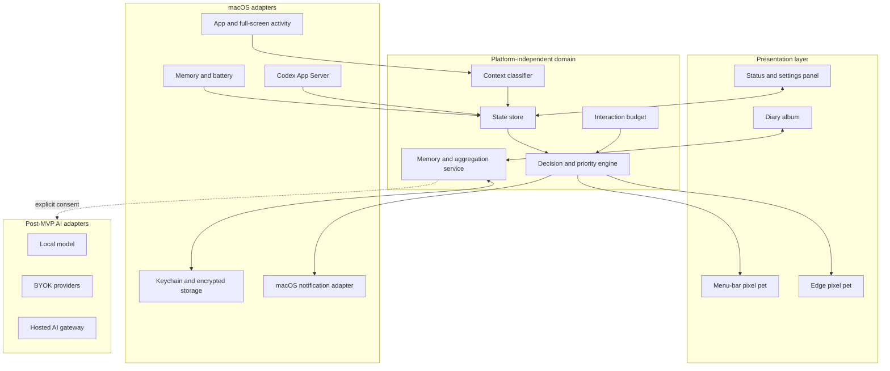
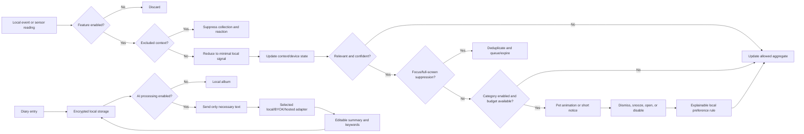

# AI Desktop Buddy — Product and Engineering Design

**Status:** Approved design baseline; memory-status revision approved 2026-09-15
**Version:** 0.2
**Initial platform:** Apple Silicon Macs, macOS 13 Ventura or later
**Distribution:** Signed and notarized direct download first; Mac App Store considered later
**Team constraint:** Solo development, one-month private alpha and up to three months for a public MVP

## Executive decision

Build a quiet, local-first pixel-art Mac companion that supports both the user and their laptop. The non-AI product must remain useful on an 8 GB Apple Silicon Mac: it displays a user-selected status, notices broad work patterns, reports actionable device conditions, suppresses interruptions during focused or full-screen activity, and provides a local diary.

The product is not a therapist, does not diagnose emotions, does not read everything by default, and does not require an account for local features. Conversational emotional support, AI diary processing, hosted AI, local-model support, browser content awareness, microphone-based noise classification, and temperature monitoring follow only after the local core is stable.

### Decision types

- **Fact:** The original M1 MacBook Air shipped with macOS 11 Big Sur. The chosen macOS 13 minimum is a product decision, not an M1 hardware limitation.
- **Fact:** The official Codex App Server currently exposes rate-limit percentage, quota-window duration, and reset time through `account/rateLimits/read`.
- **Assumption to validate:** A native Swift/AppKit application can meet the desired idle resource budget while running the selected sensors and small pixel animations.
- **Assumption to validate:** Users value Codex allowance, understandable memory-usage status, and battery status enough to keep the buddy running.
- **Open feasibility question:** Claude Code provides an interactive `/usage` view, but a supported programmatic integration has not yet been established.
- **Design opinion:** Native macOS implementation is more important than sharing UI code prematurely with a future Windows version.

## 1. Product vision

Create a laptop buddy that feels present without demanding attention. It supports two forms of well-being:

1. **User support:** recognizes broad patterns such as prolonged activity, focused work, rapid application switching, idle time, and full-screen use, then offers brief, nonjudgmental support.
2. **Device support:** makes technical conditions understandable to users who may not know what memory usage, compression, swap activity, battery state, or service allowance means.

The differentiator is not constant AI conversation. It is restrained awareness: local signals produce most behavior, AI is optional, and silence is an intentional action.

### Product promise

> A quiet pixel companion that understands enough about your work session and your Mac to be helpful, while keeping observation local and under your control.

### Non-goals

- Diagnosing stress, depression, attention disorders, or other psychological conditions
- Behaving like a therapist or medical professional
- Reacting to every action
- Continuously uploading screenshots, audio, browsing content, or activity history
- Automatically quitting applications or changing system settings
- Pretending to have feelings, needs, suffering, or emotional dependence

## 2. Target user

### Initial audience

- Adults aged 18 and over
- Students in computing-heavy courses
- Developers and early-career knowledge workers
- Users of Codex, and eventually Claude Code
- Owners of Apple Silicon Macs, including 8 GB configurations

The product may be used by younger people, but the initial release is presented as intended for adults. There is no age-verification system in the MVP. This reduces onboarding friction but does not remove the need for careful emotional-safety behavior.

### Targeting tension

Codex and Claude Code allowance monitoring is developer-specific. If positioned to all students, those integrations must be optional modules rather than the product's only practical value. Battery, understandable memory usage, focus suppression, inactive-application review, and the companion experience provide the broader value.

## 3. Core user experience

### First five minutes

1. The user launches the app and chooses a pixel pet. The walking-skeleton prototype starts with a compact pixel pig whose idle animation is a short ear wiggle, while the future pet-selection system remains deferred.
2. A short onboarding explains local-first behavior and requests only the permissions needed for selected features.
3. The user chooses one menu-bar status: battery, memory usage, Codex allowance, or another available metric.
4. The pet appears in the menu bar and changes color plus pixel pattern to represent that metric.
5. Clicking it plays a short animation in which the larger pet appears to grow out of the menu bar and settles on a selected screen edge.
6. The user can open settings, review pending notices, or write a manual diary entry.

### Ordinary day

- The pet remains in its small menu-bar form most of the time.
- The user can summon the edge form manually.
- During focused or full-screen work, unsolicited bubbles are hidden and deduplicated into a small pending queue.
- Device warnings are phrased as suggestions, not commands.
- The pet acknowledges observable effort or duration without claiming to know the user's emotion.
- Local features remain functional without an account, internet connection, API key, or AI model.

### Example messages

Good:

- “You've had a long active session. A short pause might help.”
- “Memory usage has stayed above 85%. Want to review the apps using the most memory?”
- “Your Codex window resets at 16:40.”

Avoid:

- “You're stressed.”
- “You're procrastinating again.”
- “Close Chrome now.”
- “You ignored me.”

## 4. Pet behavior model

The pet has a personality but does not claim feelings or emotional needs.

### MVP personality

- Warm, brief, observant, and nonjudgmental
- Does not repeatedly ask the user how they want to solve a problem
- Acknowledges work without inventing details
- Uses uncertainty when interpreting behavior
- Never guilt-trips the user for dismissal, silence, absence, or disabling features

### Interaction modes

The intervals are maximum eligibility rates, not guaranteed speech schedules:

| Mode | Earliest ordinary proactive message | Intended behavior |
| --- | ---: | --- |
| Quiet | 60 minutes | Rare, strongly relevant prompts |
| Balanced | 45 minutes | Occasional contextual support |
| Lively | 20 minutes | More visible but still event-dependent |

A message is eligible only when a relevant event exists, confidence is sufficient, suppression is inactive, the category is enabled, and the same condition has not recently been handled.

For the private alpha, `relevance` and `confidence` are explicit normalized scores in the
closed range `0.00...1.00`; they are not inferred booleans and may not default to a passing
value. Relevance estimates how useful and actionable a prompt is at that moment. Confidence
estimates how directly the available local signal supports the condition, independently of
how urgent the condition is.

| Mode | Minimum relevance | Minimum confidence |
| --- | ---: | ---: |
| Quiet | 0.85 | 0.80 |
| Balanced | 0.70 | 0.80 |
| Lively | 0.55 | 0.80 |

The first alpha event scores are deterministic and inspectable:

- Low battery while unplugged: `relevance = 1.00 - 0.02 * (chargePercent - 10)`, clamped
  to `0.00...1.00`; confidence is `1.00`. This yields `0.80` at 20% and `0.98` at 11%.
- High memory state: `relevance = 0.70 + 0.02 * (usagePercent - 85)`, clamped to
  `0.00...1.00`; confidence is `0.90`. This yields `0.70` at 85% and `1.00` at 100%.
- Critical battery carries relevance and confidence of `1.00`, but remains outside the
  ordinary-message scoring and cooldown gate. Existing focus/full-screen presentation
  behavior still applies.

An ordinary event below either threshold is queued for later inspection but does not open
an unsolicited bubble. Interaction mode changes the relevance threshold and cooldown, never
the minimum evidence quality. New event categories must define and test their score source
before becoming eligible; no generic passing default is allowed.

### Adaptation

The first adaptation system is explainable and rule-based:

- Snoozing increases the cooldown for that category.
- Disabled categories never produce prompts.
- Repeated immediate dismissal suppresses similar prompts during similar hours.
- Ignoring a message alone is not interpreted as dislike.
- Learned suppressions are visible, editable, and resettable.

No language model schedules routine notifications.

## 5. Interaction model

### Surfaces

1. **Menu-bar pet:** persistent, compact, and displays one user-selected metric.
2. **Edge pet:** larger multi-color pixel sprite anchored to one of the four screen edges. The user can drag it along or between edges and adjust its size; edge, position, and size persist locally. The menu-bar pet retains status-driven colors.
3. **Status panel:** opened from the pet; uses explicit Battery, Memory, and Pet settings buttons instead of a labeled metric selector. It shows a compact primary-metric summary first. Technical fields such as compression, swap, and system pressure stay collapsed behind an interactive button inside a scrollable content area. The panel also provides pending notices and quick routes.
4. **Diary album:** opened from the pet; organizes local entries and daily keyword cards.
5. **Future conversation panel:** a larger surface for AI conversation; long conversations do not occur inside tiny bubbles.

### Input behavior

- Only the visible pet silhouette accepts clicks. Its hitbox includes the narrow
  grid spacing immediately between or beside visible sprite pixels, so the pixel-art
  treatment does not create accidental dead spots.
- Empty sprite cells, outer padding, and all other transparent window areas pass clicks
  through.
- The menu-bar control remains a reliable recovery route.
- Hover presentation uses a deliberate delay to avoid accidental activation.
- The edge pet does not roam freely in the MVP.

### Focus and full-screen behavior

- The edge pet retreats to the menu bar by default.
- Ordinary bubbles are suppressed.
- Clicking or deliberately hovering over the pet reveals pending notices.
- At most three current notices are shown; duplicates merge and stale messages expire.
- Critical conditions change the menu-bar appearance immediately.
- System notifications for urgent device conditions are separately configurable.

### Accessibility baseline

- Reduced-motion mode
- Animation and sound toggles
- Status encoded through pixel shape/pattern as well as color
- VoiceOver labels
- Keyboard navigation for panels
- Adjustable text size and sufficient contrast

## 6. Context detection system

### MVP local signals

| Signal | Purpose | Default retention | Privacy level |
| --- | --- | --- | --- |
| Foreground application identifier | Work category and focus detection | Aggregated daily | Medium |
| Application-switch timestamps | Detect rapid switching and stable focus | Rolling buffer, then aggregate | Medium |
| Generic input activity timestamp | Active, idle, and away estimation | Rolling buffer, then aggregate | Low |
| Full-screen state | Suppression | Not retained | Low |
| Memory usage, compression, swap, and OS pressure | Device support | Latest sample plus aggregated daily events | Low |
| Battery state | Status and device support | Aggregated daily events | Low |
| Codex quota window | Selected status | Latest value plus optional daily aggregate | Medium |

### Memory status decision

The user-selected memory metric is driven primarily by non-cache physical-memory occupancy rather than macOS memory pressure. The intent is to warn before sustained memory demand produces avoidable compression and swap activity while still excluding readily reclaimable file cache.

```text
MemoryUsage:
  used = physical memory - free/speculative memory - purgeable/file-backed cache
  usage = used / physical memory

Menu-bar level:
  normal   < 70%
  elevated 70%–84%
  high     >= 85%
```

- Sample every ten seconds using public Mach host statistics.
- The first valid sample sets the visible level immediately.
- A later escalation requires two consecutive samples at the higher level.
- High begins recovery below 80%; elevated begins recovery below 65%.
- A downgrade requires 60 continuous seconds below its recovery threshold.
- Compressed memory, swap used, current swap-out rate, and macOS memory pressure remain visible diagnostic fields but do not directly determine the menu-bar color.
- Swap used is historical occupancy, not proof of current disk writes. Advice about active swapping uses the change in cumulative swap-outs, not the stored swap total alone.
- The app suggests reviewing high-memory applications; it never closes them automatically or claims that an application is safe to quit.

### Focus inference

```text
Known work-category application is foreground
+ recent generic user activity
+ low switching frequency
+ sustained duration
= possible focused-work session
```

The system does not look for a compiler process. Compilers are often short-lived background processes, and an open IDE does not prove active coding.

### Inactive-application review

- Default threshold: not foregrounded for two hours
- The buddy only suggests reviewing the application.
- It never claims the application is safe to close.
- Known media, meeting, and background-work applications should be excluded where practical.
- The user can exclude any application or disable the feature.

### Deferred signals

- Browser domain or page title
- Screen capture and OCR
- Sound-level category
- Temperature
- Clipboard, notification contents, files, and messaging contents

Keyboard monitoring, if used for activity detection, records only activity timestamps/counts. It never records keys or typed text.

## 7. AI architecture

### AI-free base mode

All of the following work without AI:

- Animation and presentation
- Battery, memory, and supported service allowance
- Focus/full-screen suppression
- Inactive-application review
- Notification rules and adaptation
- Manual diary and user-selected keywords
- Aggregated history

### Optional AI modes

| Mode | Benefit | Main cost/risk | Stage |
| --- | --- | --- | --- |
| Local model | Maximum data control | RAM, storage, setup, model variability | Later |
| BYOK API | Low operator cost, provider choice | Onboarding and key management | Version 2 |
| Hosted service | Simplest user experience | Billing, abuse, privacy, uptime, safety | Version 2/private beta |

The distributed app never contains the developer's provider key. A hosted service uses an authenticated backend with quotas, rate limits, safety checks, and a no-content-logging policy.

### Separate AI tasks

- Conversation response
- Diary summarization
- Keyword and memory extraction
- Optional proactive-message wording
- Critical-risk detection and response support

Each task has separate prompts, permissions, model requirements, evaluation sets, and retention rules, even if one provider initially performs several tasks.

### When AI is called

- The user starts a conversation.
- The user requests diary summarization.
- The user enables automatic diary processing and a new eligible entry/session exists.
- A future context event passes local significance and consent gates.

Routine hardware notices, focus detection, and notification timing do not call AI.

## 8. State architecture

User activity, device conditions, interaction preferences, and presentation are independent. The system does not store “stressed” as an observed fact.

```text
UserActivity:
  UNKNOWN | ACTIVE | FOCUSED_WORK | RAPID_SWITCHING | FULLSCREEN | IDLE | AWAY

DeviceCondition:
  MemoryUsage { usedBytes, totalBytes, usagePercent, normal | elevated | high }
  MemoryDiagnostics { compressedBytes, swapUsedBytes, swapOutRate, systemPressure }
  Battery { charging | normal | low | critical }
  CodexAllowance { unavailable | normal | low | exhausted }
  FutureTemperature { normal | elevated | high }

InteractionMode:
  QUIET | BALANCED | LIVELY

PetPresentation:
  MENU_IDLE | EMERGING | EDGE_IDLE | RETREATING | FOCUS_HIDDEN |
  DEVICE_NOTICE | SPEAKING
```

The menu bar visualizes exactly one user-selected metric at a time. Notification priority still applies independently:

1. Critical temperature or battery
2. Sustained high memory usage or active swap writes
3. Long active session
4. Inactive-application suggestion
5. Casual emotional support

## 9. Memory architecture

### Three layers

1. **Ephemeral context:** recent application transitions and activity timestamps used for classification; discarded after a short rolling window.
2. **Daily aggregates:** focused minutes, active-session duration, switching counts, device-condition events, and notification responses.
3. **Diary memory:** user entries, editable daily summaries, fixed mood/status categories, and optional free-form keywords.

### Diary summary record

```text
Date
Themes
User-stated feelings
Inferred tone (explicitly labeled as inferred)
Helpful response style
Topics or response styles to avoid
Source entries retained: yes/no
```

Broad session topics and interaction preferences may be summarized automatically if enabled. Sensitive autobiographical facts require stronger protection and must be visible and editable. Medical or psychological diagnoses are never inferred as facts.

### Deletion

- Delete one entry
- Delete a keyword/status
- Forget one day
- Clear all diary and derived memory
- Reset learned interaction preferences

Deleting source material also deletes summaries or memories derived exclusively from that material.

## 10. Privacy model

### Principles

- Local-first, permission-gated, and useful with every sensitive permission denied
- No account for local functionality
- No raw keystrokes, typed text, or click contents
- No screenshots by default
- No continuous browser-content observation
- No raw microphone recording retained
- No automatic application termination
- Every learned rule and retained summary is inspectable and deletable

### Progressive permissions

1. Device health only
2. Application names and duration
3. Optional window titles
4. Optional browser domains
5. Optional page titles
6. Future explicit content or screenshot permission

### Sensitive contexts

Built-in and user-defined exclusions cover password managers, banking, private browsing when detectable, messaging, video calls, and other chosen applications. Detection is defense-in-depth, not a guarantee: failure to recognize a sensitive field never becomes permission to collect content.

### Diagnostics decision

Use opt-in anonymous diagnostics. Diagnostics may include crashes, app version, device class, sensor failures, animation frame-rate summaries, and coarse CPU/memory measurements. They exclude diary content, application names, window titles, domains, prompts, AI responses, and activity timelines. Local logs are readable and deletable.

### Cloud wording

The product distinguishes:

- Stored locally
- Temporarily transmitted for processing
- Retained or not retained by the buddy backend
- Provider retention governed by the chosen provider/account policy

“Never stored” is used only when it is technically and contractually accurate for every part of the request path.

## 11. Technical stack

### Selected stack

- Swift
- SwiftUI for panels, settings, diary, and history
- AppKit for `NSStatusItem`/menu-bar behavior, transparent windows, hit-testing, screen-edge placement, and system integration
- Structured concurrency for sensor services
- `OSLog` for privacy-aware local diagnostics
- CryptoKit plus a Keychain-held key for sensitive diary fields, or an equivalently audited encrypted-store design
- Local SQLite-backed repository hidden behind a storage protocol
- `URLSession` for future provider and hosted-backend adapters
- XCTest for core rules, data migration, and adapter contracts

### Cross-platform strategy

Do not use Electron solely for hypothetical Windows reuse. Keep domain models, JSON schemas, thresholds, and decision rules independent of AppKit. Create platform protocols for sensors, secure storage, notifications, and presentation. A future Windows version can implement those interfaces natively; extraction into a shared Rust core is considered only after the domain stabilizes.

### Minimum platform

- Apple Silicon only
- macOS 13 Ventura or later
- 8 GB RAM for base mode
- Local-model requirements stated separately per model

## 12. MVP feature list

### One-month private alpha

- Menu-bar pixel pet
- Edge-anchored pixel pet
- Idle, emerge, retreat, focus/sleep, warning, and speaking animations
- User-selectable edge position
- Click-through transparent window outside the visible hitbox
- Selected metric: battery, memory usage, or Codex allowance
- Memory-usage, memory-pressure diagnostic, swap, and battery sensors
- Codex App Server rate-limit adapter
- Basic active/idle and full-screen suppression
- Quiet, balanced, and lively interaction modes
- Deduplicated pending-notice list
- Basic settings and permission explanation
- Signed private build

### Three-month public MVP

- Robust multi-display and menu-bar behavior
- Focus inference from application category, duration, activity, and switching rate
- Inactive-application review suggestions
- Explainable local preference learning
- Aggregated daily statistics
- Manual diary album with editable keywords
- Local encryption and deletion controls
- Accessibility baseline
- Opt-in privacy-safe diagnostics
- Performance and battery profiling
- Crash recovery and data-migration tests
- Polished onboarding
- Signed, notarized web download
- Claude Code allowance only if a supported integration passes the technical spike

## 13. Features intentionally excluded from MVP

- Conversational emotional-support AI
- Automatic AI diary summarization
- Hosted AI billing/service
- Bundled local language model
- Browser domain, title, or page-content awareness
- Screenshot capture, OCR, or vision analysis
- Surrounding-noise classification
- Temperature monitoring
- Voice interaction
- Free desktop roaming or window sitting
- Multiple generated/evolving personalities
- App Store release
- Windows version
- Cloud sync
- Automatic application closing or system optimization

## 14. System architecture diagram



## 15. Data flow diagram



## 16. Suggested repository structure

Start with one application target and one test target. The folders are architectural boundaries, not separate packages until separation produces a real benefit.

```text
DesktopBuddy/
├── DesktopBuddy.xcodeproj
├── App/
│   ├── DesktopBuddyApp.swift
│   ├── AppCoordinator.swift
│   └── DependencyContainer.swift
├── Core/
│   ├── Models/
│   ├── State/
│   ├── ContextClassification/
│   ├── DecisionEngine/
│   ├── InteractionBudget/
│   └── Protocols/
├── Platform/
│   └── macOS/
│       ├── Sensors/
│       ├── CodexIntegration/
│       ├── Permissions/
│       ├── Notifications/
│       ├── SecureStorage/
│       └── WindowManagement/
├── Features/
│   ├── MenuBarPet/
│   ├── EdgePet/
│   ├── StatusPanel/
│   ├── PendingNotices/
│   ├── Settings/
│   └── Diary/
├── Resources/
│   ├── PixelArt/
│   └── Localization/
├── Tests/
│   ├── CoreTests/
│   ├── SensorContractTests/
│   ├── DecisionEngineTests/
│   └── StorageMigrationTests/
└── docs/
    ├── privacy-model.md
    ├── architecture-decisions.md
    └── sensor-feasibility.md
```

## 17. Development milestones

### Week 1 — Walking skeleton

- Xcode project, menu-bar item, status panel, settings persistence
- Static pixel pet and animation player
- Battery and memory-usage adapters, with system pressure and swap diagnostics
- Core state types and tests

**Exit:** The pet runs from the menu bar and displays real battery or non-cache memory-usage state.

### Week 2 — Companion presentation

- Transparent edge window and hit-testing
- Emerge, retreat, idle, focus/sleep, warning, and speaking animations
- User-selected screen edge
- Full-screen retreat and manual summon

**Exit:** Both visual forms work without obstructing other applications.

### Week 3 — Decisions and Codex

- Interaction modes and eligibility rules
- Pending-notice deduplication and expiry
- Codex App Server feasibility and adapter
- App activity categories and minimal focus inference

**Exit:** A real local event produces a correctly suppressed or displayed response, and Codex allowance is shown when configured.

### Week 4 — Private alpha

- Onboarding and permission explanations
- Accessibility baseline
- Resource profiling and sensor backoff
- Crash handling, signing, packaging, and private installation test

**Exit:** The developer can use the app for several full workdays without meaningful obstruction or instability.

### Months 2–3 — Public MVP

- Explainable adaptation
- Inactive-application review
- Aggregated history
- Manual encrypted diary album
- Multi-monitor hardening
- Opt-in diagnostics
- Claude Code spike and integration only if supported
- External testing, bug fixing, notarization, and release preparation

## 18. Major technical risks

| Risk | Impact | Mitigation |
| --- | --- | --- |
| Claude Code lacks a stable programmatic usage interface | Mandatory integration cannot ship reliably | Technical spike first; allow Codex-only launch |
| Menu-bar hover/custom animation behavior is fragile | Core visual identity feels inconsistent | AppKit prototype in Week 1; click remains reliable fallback |
| Edge window interferes with clicks, Spaces, or multiple displays | Users uninstall quickly | Strict hitbox, fixed anchors, retreat command, multi-display tests |
| Resource monitoring consumes noticeable energy | Contradicts product promise | Event-driven APIs, slow sampling, Low Power backoff, Instruments profiling |
| Memory-usage thresholds create noisy advice or diverge from Activity Monitor | Loss of trust | Exclude reclaimable cache, show the exact percentage, use hysteresis, retain OS pressure as context, and test calculations across supported macOS versions |
| Codex App Server/auth evolves | Integration breaks | Adapter boundary, version detection, unavailable state, no secret scraping |
| Diary encryption or deletion is incomplete | Severe privacy harm | Threat model, migration/deletion tests, minimal backups, explicit exports |
| App Store policies conflict with sensors or helpers | Later distribution blocked | Prefer public APIs; review App Store constraints before adding privileged helpers |
| One-month art and animation workload is underestimated | Engineering stalls on assets | Six animation limit, temporary developer sprites, fixed frame sizes |

## 19. Cost risks

### MVP

- Apple Developer Program membership and signing/notarization
- Pixel-art production time or commissioned assets
- Testing across multiple Apple Silicon/display configurations
- Optional crash-reporting service
- Website/download hosting

### Hosted AI later

- Unbounded model usage and abusive accounts
- Provider price changes
- Moderation and safety-processing cost
- Authentication, backend, observability, and support cost
- Refunds, taxes, regional availability, and payment fees
- Sensitive-data incident response

Controls include per-user quotas, model tiers, short structured contexts, cached non-sensitive prompts, output limits, separate paid AI allowance, and BYOK/local alternatives. The developer's personal API key is never distributed.

### Commercial direction

- Initially free local core
- AI diary/conversation features paid or usage-limited
- Later, a one-time purchase for the mature local core
- Testers may receive discounted licenses when commercialization begins
- Local features still require no account; tester discounts can use license codes or purchase accounts without attaching behavioral history

## 20. Future expansion possibilities

### Version 2

- Manual AI conversation with separate prompt and safety policies
- AI diary summary and editable memory extraction
- BYOK providers
- Hosted AI private beta
- Local-model adapter
- Temperature feasibility implementation
- Sound-level category with raw audio immediately discarded
- User-selectable personality packs
- Additional device-health statuses and quick routes

### Longer term

- Windows native presentation and sensor adapters
- Browser-specific optional domain/page-title integrations
- Explicit screenshot understanding for user-initiated requests
- Voice interaction
- Plugin/integration system
- Optional encrypted sync
- Additional pet assets and edge movements
- Validated proactive help for more work contexts

### Research, not promises

- Inferring possible overload from multiple behavioral signals
- Personalized interruption timing beyond explainable rules
- Emotionally sensitive long-term memory
- On-device small-model classification
- Context-aware proactive help without content surveillance

## Why this product might fail

1. **It may be a novelty rather than a habit.** A charming animation can create strong first-day interest without week-four value.
2. **The two value propositions may not reinforce each other.** Emotional companionship and system monitoring could feel like unrelated products sharing a mascot.
3. **Helpful reminders may become background noise.** Even well-intended prompts can feel repetitive, generic, or patronizing.
4. **The app may infer too much from too little.** App switching and session duration are ambiguous; inaccurate emotional framing would quickly damage trust.
5. **The privacy story may be too complicated.** Extensive customization does not automatically make broad observation feel safe.
6. **External usage integrations may break.** Codex and Claude Code are controlled by other companies and can change independently.
7. **The app may consume more resources than the value it provides.** A laptop companion that worsens battery life or memory pressure contradicts itself.
8. **The diary may not be used.** Users already have notes, journals, chatbots, and dedicated mental-wellness products.
9. **A solo developer may overextend.** Native animation, telemetry, privacy, AI safety, backend operations, Windows, and App Store distribution are each substantial areas.
10. **Emotional support creates safety expectations.** Users may treat a friendly companion as more capable than it is, especially during serious distress.
11. **The initial audience may be too narrow.** Codex allowance is distinctive for developers but irrelevant to most laptop users.
12. **Monetization may feel inconsistent.** Moving formerly free local features behind a later one-time purchase could upset early users unless the transition is communicated clearly.

## What would make this genuinely useful instead of a gimmick?

The buddy must repeatedly do at least one practical thing better than a static widget while remaining pleasant enough to keep visible.

That requires:

- Device advice that is timely, understandable, and actionable
- A menu-bar status users genuinely glance at
- Suppression that is more trustworthy than notification generation
- Observable improvement in unwanted-prompt frequency through explainable learning
- A diary that retrieves useful patterns without misrepresenting the user
- Performance light enough that users forget the process is running
- Clear boundaries: it acknowledges effort, never claims diagnosis, and never manufactures intimacy
- Local functionality strong enough that AI feels like an enhancement rather than the product's only intelligence

The most important validation question is not “Do users like the pet?” It is:

> After the novelty fades, which specific action or insight makes users choose to keep it running every day?

## Final challenge before implementation

The design is coherent enough for a technical prototype, but not yet validated as a business or habit. The one-month alpha should test the riskiest assumptions in this order:

1. Can the menu-bar and edge-pet experience remain technically unobtrusive?
2. Can memory, battery, and Codex status create repeatable daily value?
3. Can focus suppression and pending notices prevent annoyance?
4. Can the base process meet its resource targets on an 8 GB M1 Mac?
5. Do users understand and trust the privacy controls?
6. Does a manual diary belong in this product, or is it feature expansion without evidence?

Do not begin hosted AI, browser observation, audio sensing, or Windows development until the alpha answers the first four questions positively.

## Preliminary evaluation plan

The owner will finalize evaluation design after self-testing. The alpha should nevertheless record local, privacy-safe measures that the tester can inspect and optionally share:

- Days the buddy remained enabled
- Number of notices shown, opened, snoozed, and disabled
- Number of suppressed/merged notices
- Which selected status modes were used
- Whether a device suggestion led to opening the detailed panel
- Approximate idle CPU, memory, and battery impact
- Diary days used, without diary content

Qualitative questions should ask what users would miss if the app disappeared, which notice felt most useful, which behavior was annoying, and whether they trusted the observation controls.

## Current source notes

- [Apple M1 MacBook Air accessibility report](https://support.apple.com/content/dam/edam/applecare/images/en_US/otherassets/accessibility/vpat_macbookair_m1_2020.pdf)
- [Apple MenuBarExtra documentation](https://developer.apple.com/documentation/swiftui/menubarextra)
- [Apple Activity Monitor memory-usage documentation](https://support.apple.com/guide/activity-monitor/view-memory-usage-actmntr1004/mac)
- [Apple memory-pressure guidance](https://support.apple.com/guide/activity-monitor/check-if-your-mac-needs-more-ram-actmntr34865/mac)
- [Official Codex App Server documentation](https://learn.chatgpt.com/docs/app-server)
- [Official Codex pricing and allowance documentation](https://learn.chatgpt.com/docs/pricing)
- [Claude Code usage command reference](https://support.claude.com/en/articles/14553413-claude-code-cheatsheet)
- [Raycast macOS requirements change](https://www.raycast.com/changelog/macos-v1)
- [CleanMyMac system requirements](https://cleanmymac.com/faq?category=optimization)
